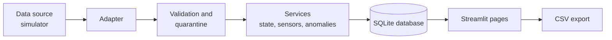

# Textile Machine Intelligence

A local monitoring application that shows what each textile machine is doing, how long it ran or stood still, and which readings or conditions need attention.

## Overview

Textile Machine Intelligence collects machine states (running, stopped, unknown) and sensor readings, checks them for quality, and turns them into clear status views, runtime reports and alerts. It only reads data. It never sends commands to a machine.

This release works with a built-in simulator that produces clearly labelled synthetic data. It has not been connected to real machines or tested on a shop floor.

## Industrial Problem

In many mills, machine status and downtime are recorded by hand or are not recorded at all. This causes everyday problems:

- Nobody can say with confidence how long a machine ran or stood idle during a shift.
- A missing signal is easily mistaken for a stopped machine, or the other way round.
- When a data link fails, the gap in the record is hidden instead of shown.
- Sensor readings go out of range or stop arriving, and nobody notices until later.
- Maintenance notes are kept apart from the machine data they relate to.

Without a trustworthy record, it is hard to plan maintenance or to discuss downtime with facts.

## Proposed Solution

The application keeps one record per machine and is strict about what it knows and what it does not know.

- A machine is shown as running or stopped only when recent, valid data says so.
- If data is old, the machine is shown as **Unknown**. It is not shown as stopped.
- If the data source is down, the machine is shown as **Disconnected**. That time is counted as a **monitoring gap**, not as downtime.
- Bad records, such as a non-numeric reading or an unknown sensor, are set aside with a reason. They are never used in calculations.
- Rules raise alerts for readings above or below limits you set, for sensors that stop reporting, and for data problems.
- Maintenance records are typed in by people and are clearly marked as user-entered.

## Key Capabilities

These features are implemented in the current release.

| Area | What it does |
|---|---|
| Machine registry | Add, edit and deactivate machines. Deactivating keeps all history. |
| Live status | Running, Stopped, Unknown or Disconnected for each machine, with the last known state and how long it has lasted. |
| Runtime accounting | For any period: running, stopped, reported-unknown and monitoring-gap time. These four always add up to the full period. |
| Runtime share | Running time divided by running plus stopped time. Shown as "n/a" when there is no known time. |
| Sensor monitoring | Latest values, units (or "unit unknown"), data freshness and charts that break where data is missing. |
| Data quality checks | Rejects invalid numbers, bad or future timestamps, unknown machines or sensors, wrong units and invalid states. Ignores duplicate records. |
| Late data handling | Records that arrive late are stored with their real event time and do not overwrite the current state. |
| Anomaly alerts | Threshold, stale sensor, long running or stopped time, rejected or out-of-order record, and source unavailable. Each alert can be acknowledged, noted and resolved. |
| Maintenance log | Record inspections, repairs and other work, with an optional link to an alert on the same machine. |
| CSV export | State history, runtime summary, sensor readings, anomalies and maintenance records. |
| Backup and restore | Database backup, verified restore and a protected reset. |

The runtime share is not OEE and is not a measure of factory availability.

## How It Works

**Input.** A data source supplies machine states and sensor readings. In this release the source is the built-in simulator.

**Process.** Each record is checked. Valid records are stored. Invalid records are kept aside with a reason. Rules look for alerts. Status and runtime are worked out from the time each event happened, not the time it was received.

**Output.** You see the results in the browser and can export them as CSV files.

A typical session:

1. Open the Dashboard to see which machines are running, stopped, unknown or disconnected.
2. Open a machine to see its timeline for the last few hours.
3. Check the Anomalies page and acknowledge or resolve alerts with a note.
4. Record any maintenance work on the Maintenance page.
5. Export a runtime summary for a chosen period from the History page.

## System Architecture



- **Adapter.** A read-only interface for data sources. It reports failures as errors and never hides them as empty results.
- **Core logic.** Plain Python modules in `src/core` handle time accounting, status rules, validation and alert rules. They do not depend on the database or the screen, so they are easy to test.
- **Services.** Code in `src/services` stores and reads data and applies the core logic.
- **Database.** One local SQLite file.
- **Pages.** Seven Streamlit pages in `src/ui`.

Timestamps are stored in UTC and shown in a time zone you can change. Reporting periods include the start time and exclude the end time.

## Technology Stack

| Technology | Purpose |
|---|---|
| Python 3.11 or newer | Application language |
| Streamlit | Browser interface |
| SQLAlchemy 2.x with SQLite | Local database |
| pandas | Tables on the pages |
| Plotly | Charts |
| tzdata | Time zone data, needed on Windows |
| pytest, Ruff | Tests and code checks |

All of these are free and open source. No paid service, account or internet connection is needed after installation.

## Installation & Setup

### Prerequisites

- Python 3.11 or newer. On Windows, tick "Add python.exe to PATH" during installation.
- Internet access for the first installation only.

### Install on Windows

Open Command Prompt or PowerShell in the project folder, then run:

```bat
scripts\setup.bat
```

This creates a `.venv` folder and installs the packages listed in `requirements.txt`.

### Install manually (any system)

```bash
python -m venv .venv
# Windows:  .venv\Scripts\activate
# Linux/macOS:  source .venv/bin/activate
python -m pip install -r requirements.txt
```

### Run the application

```bat
scripts\run.bat
```

Or, with the environment active:

```bash
python -m streamlit run app.py --server.address 127.0.0.1
```

Open http://127.0.0.1:8501. The application listens on this computer only.

### Configuration

All settings are optional.

| Variable | Default | Meaning |
|---|---|---|
| `TMI_DATA_DIR` | `data` in the project folder | Folder for the database, backups and logs |
| `TMI_DB_PATH` | `<data folder>/textile_machine_intelligence.db` | Database file |
| `TMI_LOG_LEVEL` | `INFO` | `DEBUG`, `INFO`, `WARNING` or `ERROR` |
| `TMI_TIMEZONE` | `Asia/Kolkata` | Default reporting time zone |
| `TMI_FRESHNESS_SECONDS` | `300` | How old a state can be before it counts as stale |

Set a variable before starting the app. In Command Prompt use `set TMI_TIMEZONE=UTC`. In PowerShell use `$env:TMI_TIMEZONE="UTC"`.

Limits, severities and time zone can also be changed on the Settings page. All default numbers are example values. They are not industry standards, so set them to suit your machines.

## Usage

### First run

1. Open **Settings**, then the **Simulation** tab.
2. Click **Initialise synthetic demo data**. This creates four demo machines with six hours of history.
3. Open **Dashboard** to see their status.

The demo history includes a high reading, a period of unknown state, a machine that stops reporting while the source is healthy, a short source interruption, late records and ten invalid records.

### Pages

| Page | Use it to |
|---|---|
| Dashboard | See machine status, a runtime summary and recent changes and alerts |
| Machines | Register machines and view one machine in detail |
| History | Review runtime and state changes for a chosen period and export CSV files |
| Sensors | See latest readings, freshness, charts and rejected records |
| Anomalies | Filter, acknowledge, add notes to and resolve alerts |
| Maintenance | Record and edit maintenance work |
| Settings | Change limits, time zone and severities, run the simulation, and manage the database |

### Simulation controls

- **Poll simulated source now** adds new simulated records up to the present time.
- **Simulate source interruption** makes the source fail for a few minutes. Machines show as Disconnected, not stopped.
- **Reset simulated data** removes only simulated records. Machines, sensor definitions and your maintenance records are kept.

### Backup and restore

- Create a backup on the Settings page under **Database**, or run `python scripts/db_tools.py backup`.
- Close the application, then restore with:

```bat
scripts\restore_backup.bat data\backups\<backup file>.db
```

The backup is checked first, and the current database is saved as a safety copy.

### Run the tests

```bat
scripts\test.bat
```

This runs `pytest` and `ruff check`.

## Project Structure

```text
app.py                 Application entry point
config.py              Settings read from environment variables
requirements.txt       Python packages
.streamlit/            Streamlit configuration
scripts/               Setup, run, test and database tools
src/
  core/                Time accounting, status, validation and alert rules
  data_sources/        Adapter interface and the simulator
  models/              Data types and database tables
  repositories/        Database connection, versioning, backup and restore
  services/            Machines, states, sensors, alerts, maintenance, ingestion, reports
  ui/                  Streamlit pages, charts and theme
  utils/               Time and CSV helpers
tests/                 Automated tests
docs/                  Design decisions, integration prerequisites, test report
data/                  Database, backups and logs (created at run time, not committed)
```

## Current Status

Version 0.1.0.

| Status | Items |
|---|---|
| Implemented | Everything listed under Key Capabilities, working with the simulator |
| Not implemented | Connection to real machines, controllers or gateways |
| Not implemented | Predictive maintenance or machine learning |
| Not implemented | User login or multi-user access |
| Limited | New sensors are created by the simulator. The Settings page edits limits and stale times for existing sensors but cannot create new sensors. |

The application has not been checked against real machine data or hardware. Alert limits and freshness values are example settings. Do not use this software for safety functions or to control equipment.

`docs/TEST_REPORT.md` describes what was and was not verified when the project was generated.

## Roadmap

These items are planned and are not part of the current release.

- Read-only adapters for real machines, after the steps in `docs/INTEGRATION_PREREQUISITES.md` are completed.
- A way to create and manage sensor definitions from the Settings page.
- Login and user roles for shared use on a network.
- Shift-based reports.
- Predictive maintenance, only after enough real, validated data exists.

## Contributing

1. Fork the repository and create a branch.
2. Follow the setup steps above.
3. Make a focused change and add or update tests.
4. Run `scripts\test.bat` and make sure it passes.
5. Open a pull request that explains what changed and why.

Please keep these rules:

- Keep data sources read-only. Do not add code that sends commands to machines.
- Keep the logic in `src/core` free of database and screen code.
- Never commit databases, logs, backups, credentials or private data.
- Do not present simulated data as real data.

Read `docs/DESIGN_DECISIONS.md` before changing how time, status or runtime is calculated.

## License

MIT License. See [LICENSE](LICENSE).
